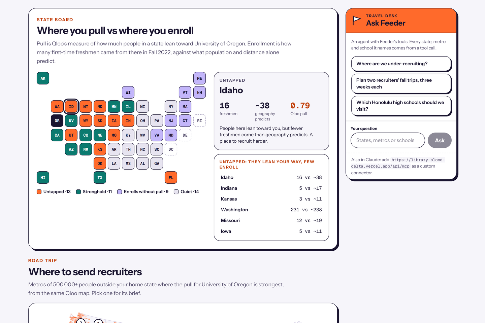
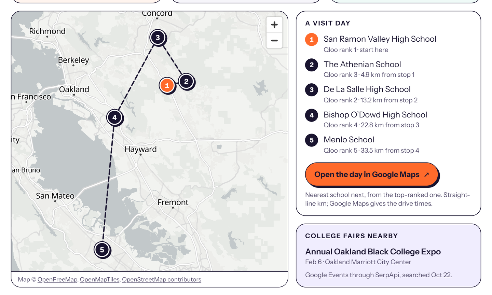

# Feeder

A recruiting desk for university enrollment teams. Feeder shows where people who lean toward a university live, compares that with where its freshmen actually come from, and turns the gap into recruiter travel: which states to work harder, which metros to send people to, and which high schools to visit when they get there.

For each of 139 four-year universities that draw at least a fifth of their freshmen from out of state, Feeder gives:

- **A state board.** For every state outside the home state: the Fall 2022 first-time freshmen the university drew, what population and distance alone predict, and its pull in [Qloo](https://qloo.com)'s taste graph. States fall into four groups. *Untapped* states lean the university's way but send fewer freshmen than geography predicts. *Strongholds* lean its way and deliver. *Enrolls without pull* states send students for reasons other than taste, and *Quiet* states do neither.
- **An audience map.** Qloo's national heatmap for the university, drawn on a US map with the campus and the top recruiting metros pinned.
- **A road trip.** The metros of 500,000+ people outside the home state where the pull is strongest. Each opens a metro brief: high schools to visit, rival colleges nearby, and the music and TV that resonate there.
- **A visit day.** The top high schools on a street map in driving order, with a Google Maps link that opens the whole route, and upcoming college fairs in that city.
- **An agent.** "Ask Feeder" answers with the desk's own tools and plans multi-week recruiter trips. The same tools work inside Claude as an MCP connector.

**Live app:** https://library-blond-delta.vercel.app (free, no sign-in)
**MCP endpoint:** `https://library-blond-delta.vercel.app/api/mcp` (in Claude: Settings → Connectors → add a custom connector)



## How it uses Qloo

1. **The university in Qloo.** `/search` with `types=urn:entity:brand`. A match counts only when the entity's name equals the federal (IPEDS) name or one of its listed aliases, ignoring case, a leading "The", punctuation and a campus label. "Ohio State University" resolving to "Ohio State Football" is dropped.
2. **A national heatmap per university.** `/v2/insights` with `filter.type=urn:heatmap`, `signal.interests.entities` set to the university and `filter.location.query=United States`. Each cell carries an affinity and a popularity.
   - **State pull** is the popularity-weighted mean affinity of the cells inside a state (`src/lib/score/pull.ts`).
   - **Metro pull** is the same over cells within 60 km of a metro (`src/lib/score/metros.ts`).
   - **The audience map** draws the cells with affinity of 0.5 or more on an Albers projection with Alaska and Hawaii insets.
3. **Metro briefs, fetched once and kept.** Within 40 km of the metro, with the university as the interest signal:
   - `filter.type=urn:entity:place` returns the places people who lean toward the university favour, sorted by name into high schools and colleges (`src/lib/brief/classify.ts`).
   - `urn:entity:artist` and `urn:entity:tv_show` give the music and TV that resonate there, for outreach and event themes.
   - Each high school keeps its coordinates for the visit-day map.

## The visit day

The day starts at the top-ranked high school and goes to the nearest one next, five stops in all (`src/lib/brief/route.ts`). Legs are straight-line kilometres; the "Open the day in Google Maps" link hands Google the whole route, which gives real drive times without a paid directions call. The map is MapLibre GL with OpenFreeMap vector tiles.

College fairs come from Google Events through [SerpApi](https://serpapi.com): one search per metro ("college fair" and the city), shared by every university and kept for three weeks. A keyword filter keeps admissions events (college fairs and expos, college nights, NACAC fairs, discovery days, HBCU fairs, financial aid and FAFSA nights) and drops study-abroad, camp and job fairs, galas and conferences. Past dates drop off on their own. Searches run under a monthly cap; when it is spent, the brief says so and metros already searched keep their fairs.

## The agent and MCP

"Ask Feeder" runs on the AI SDK (`streamText`) with Claude Haiku 5.5 through the Vercel AI Gateway. The model chooses the tool calls and writes the answer; every state, metro, school and number comes from a tool:

| Tool | What it does |
|---|---|
| `find_universities` | Find a university by name, city or state |
| `state_board` | Pull against enrollment for every state, grouped as above |
| `recruiter_metros` | The strongest-pull metros of 500,000+ people outside the home state |
| `metro_brief` | High schools, rival colleges, what resonates, the visit day and nearby college fairs |
| `plan_trips` | Recruiter travel: the strongest metros split west to east across recruiters, then into weeks of nearby stops |
| `get_evidence` | The test results below and their limits |

Trip planning is deterministic: no model decides where anyone goes. Stops in one week stay within 1,200 km of each other, and when the weeks can't hold every metro, the weakest are dropped. The same registry is served at `/api/mcp` over streamable HTTP (stateless, no sign-in). The public demo has daily limits on the agent and on new briefs.

## Evidence

The test was written down and committed before it ran ([docs/eval-plan.md](docs/eval-plan.md), with one amendment made before any score was computed). Ground truth is federal enrollment data: IPEDS first-time freshmen by state of residence, Fall 2022, with Fall 2020 as a replication. 124 universities were fixed by rule before any Qloo call on them; 109 had enough heatmap coverage to score.

Each state score was compared with **gravity**: what the state's population and its distance from campus alone predict. Two other arms ran beside Qloo. The **assistant** arm asked Claude Haiku 5.5 to rank the states from the university's name alone, with no tools or data. The **placebo** arm used another university's Qloo scores.

**Does Qloo pull explain what geography misses?** Partial Spearman with the gravity residual, mean over universities, 95% bootstrap intervals:

| Score | Fall 2022 | Fall 2020 |
|---|---|---|
| Qloo pull | **+0.32** (0.27 to 0.36) | **+0.32** (0.27 to 0.37) |
| Assistant alone | +0.28 (0.25 to 0.31) | +0.27 (0.24 to 0.30) |
| Placebo: another university's pull | +0.00 (−0.06 to 0.07) | +0.02 (−0.04 to 0.08) |

**Predicting every state, out of sample** (leave one university out, Spearman of predicted against actual):

| Model | Fall 2022 | Fall 2020 |
|---|---|---|
| Population and distance | 0.74 | 0.74 |
| … plus Qloo | 0.78 | 0.77 |
| … plus the assistant | 0.85 | 0.84 |
| … plus both | 0.85 | 0.84 |

What this means:

- **Qloo pull explains part of what geography misses,** in both years, and a placebo explains nothing. Adding it to population and distance improves prediction in both years (+0.04, interval 0.02 to 0.06).
- **It matches the assistant at that:** +0.04 ahead in 2022 (−0.01 to 0.09) and +0.05 in 2020 (0.01 to 0.09). It gets there from measured taste rather than remembered facts, and it reaches down to metros and high schools, where an assistant's memory runs thin.
- **For ranking every state, the assistant is better,** and adding Qloo to it adds nothing (−0.002). So the state board shows pull next to real enrollment for a team to read both; it does not claim Qloo beats an assistant at the ranking.

**What this does not establish:** Qloo's data is from 2026 and the enrollment data from 2020 and 2022, so this measures alignment, not a forecast. Where students come from also reflects past recruiting, alumni, athletics and price, and the test can't separate taste from those. Metros, high schools, rival colleges and what resonates are untested, because federal data has nothing below the state. Only first-time freshmen are counted.

This repository first held another product, Shelf Desk, which picked teen books for students' interests from Qloo's book graph. Its pre-registered test on library checkouts failed: the picks did no better than random. The record is kept in [docs/retired](docs/retired/README.md).



## Architecture

- **App:** Next.js 16 (App Router) on Vercel, Tailwind CSS v4, Postgres on Neon, MapLibre GL for the street map.
- **Precomputed data:** state boards, metro pull and the audience map are built ahead of time and loaded into Postgres. Metro briefs are fetched from Qloo on first open and kept, so later visitors read them from the database. Raw Qloo output stays out of the repository (`data/cache` and `data/raw` are ignored); the public-domain inputs and the evaluation's aggregate results are committed.
- **Tests:** `npm test` runs the Vitest suite (Qloo client and parameters, state pull, metro pull, the board, the brief classifier, the map projection, visit-day routing, the fair filter and trip planning).

## Run it locally

```bash
npm install
cp .env.example .env.local    # then fill in the values it lists
psql "$DATABASE_URL" -f db/schema.sql

# Build the data: federal and census sources, then Qloo
node scripts/build-data.mjs
node scripts/resolve.mjs
node scripts/resolve-more.mjs
node scripts/heatmaps.mjs
npx tsx scripts/score-states.mts
node scripts/state-paths.mjs
npx tsx scripts/load-db.mts
npx tsx scripts/load-cells.mts

npm run dev
```

To rerun the evaluation: `node analysis/assistant-arm.mjs`, then `python analysis/eval.py`.

## Data and credits

- Taste data: [Qloo](https://qloo.com) Insights API.
- Enrollment and institutions: IPEDS, National Center for Education Statistics (public domain).
- Population and places: US Census Bureau (2020 census centres of population, 2023 Gazetteer, 2025 metro estimates).
- State shapes: Natural Earth (public domain).
- Street map: OpenFreeMap tiles from OpenMapTiles and OpenStreetMap contributors.
- College fairs: Google Events results through SerpApi.

Feeder is not affiliated with any university.

Built in coordination with an AI coding assistant, Claude Code.

## License

MIT, see [LICENSE](LICENSE).
